# 实验一 · 图数据库 TuGraph 实践报告

> **课程**：专业综合实践
> **实验名称**：图数据库 TuGraph 入门与综合实践
> **实验平台**：TuGraph 4.5.2（社区版，Ubuntu 20.04 / WSL1 原生部署）
> **报告仓库**：<https://github.com/LBNG-ONE/tugraph-assignment1>

---

## 目录

- [一、实验目的](#一实验目的)
- [二、实验环境](#二实验环境)
- [三、实验原理与图模型设计](#三实验原理与图模型设计)
- [四、实验步骤与结果](#四实验步骤与结果)
  - [4.1 任务一：TuGraph 平台的部署与启动（4 分）](#41-任务一tugraph-平台的部署与启动4-分)
  - [4.2 任务二：图建模、数据导入与增删改查（4 分）](#42-任务二图建模数据导入与增删改查4-分)
  - [4.3 任务三：自定义聚合查询设计（4 分）](#43-任务三自定义聚合查询设计4-分)
- [五、遇到的问题与解决](#五遇到的问题与解决)
- [六、实验总结](#六实验总结)
- [七、参考资料](#七参考资料)
- [附录 A：数据字典](#附录-a数据字典)
- [附录 B：脚本与文件索引](#附录-b脚本与文件索引)

---

## 一、实验目的

1. 掌握分布式图数据库 **TuGraph** 的安装部署与启动流程，能够独立完成环境搭建并登录 Web 控制台。
2. 理解**属性图模型**（Property Graph）中顶点、边、属性三要素，并针对具体业务场景完成图模型设计。
3. 掌握 TuGraph 的数据导入方式（Web 可视化导入、REST/HTTP 接口批量写入、Bolt 驱动写入）。
4. 熟练使用 **Cypher** 声明式图查询语言完成数据的增、删、改、查。
5. 掌握 Cypher 的**聚合查询**能力：隐式分组、`WITH` 多阶段查询、`COUNT(DISTINCT)` 去重、排序与截断，并能针对真实业务问题独立设计聚合查询。

## 二、实验环境

| 项目 | 配置 |
|---|---|
| 宿主机 | Windows 11 家庭中文版（i7-13700H，14 核 20 线程，16 GB 内存，NVMe SSD） |
| Linux 运行环境 | **WSL1 + Ubuntu 20.04.5 LTS**（发行版磁盘由 `wsl --import` 落在 D 盘） |
| 图数据库 | **TuGraph 4.5.2 社区版**，官方 `.deb` 原生安装（不依赖 Docker） |
| 安装包 | `tugraph-4.5.2-1.x86_64.deb`（575.7 MB，自带全部运行库） |
| Web 端口 | 7070 |
| Bolt 端口 | 7687 |
| RPC 端口 | 9090 |
| 浏览器 | Google Chrome 156 |
| 客户端 | REST / HTTP API + Python `neo4j` 5.28.8 驱动（TuGraph Bolt 兼容 Neo4j） |
| 子图 | `lab1_movie` |

> **端口用途**：7070 为 Web 管理界面与 RESTful API；7687 为 Bolt 协议端口，供 Java/Python/Go 驱动连接；9090 为 RPC/监控端口。
>
> WSL1 与 Windows **共享 localhost 网络栈**，因此浏览器直接访问 `http://localhost:7070` 即可，无需端口转发。

## 三、实验原理与图模型设计

### 3.1 属性图模型

TuGraph 采用**属性图模型**，用「顶点（vertex/node）— 边（edge/relationship）— 属性（property）」三要素描述现实世界中的实体及其关联：

- **顶点**：表示实体，通过**标签（label）**分类（如 `person`、`movie`），每个顶点由**主键**唯一标识；
- **边**：表示实体间关系，同样有标签（如 `direct`、`acted_in`），且**有方向**，可带属性；
- **属性**：键值对，可为顶点或边附加描述信息，并有明确数据类型（INT32 / INT64 / DOUBLE / STRING 等）。

与传统关系型数据库相比，图的优势在于**关系即一等公民**：多跳关联查询无需 JOIN，直接沿边遍历，代价与路径长度相关而非随表规模膨胀。

### 3.2 领域模型设计

本实验选取**电影领域**作为建模对象，设计 2 个顶点标签、3 个边标签：

```
                        ┌──────────────┐
        direct (30)     │              │
   ┌───────────────────▶│              │
   │                    │              │
┌──┴───────┐            │    movie     │
│  person  │  acted_in  │              │
│          │  (47)      │  id          │
│  id      ├───────────▶│  title       │
│  name    │            │  release_year│
│  born    │  produce   │  rating      │
│  country │  (6)       │  duration    │
│          ├───────────▶│  country     │
└──────────┘            └──────────────┘
  37 个顶点                30 个顶点
```

**顶点标签定义**

| 标签 | 字段 | 类型 | 必填 | 说明 |
|---|---|---|---|---|
| `person` | `id` | INT64 | 是 | 主键，人物编号 |
| | `name` | STRING | 是 | 姓名，建普通索引 |
| | `born` | INT32 | 否 | 出生年份 |
| | `country` | STRING | 否 | 国籍 |
| `movie` | `id` | INT64 | 是 | 主键，影片编号 |
| | `title` | STRING | 是 | 片名，建普通索引 |
| | `release_year` | INT32 | 否 | 上映年份（避开保留字 `year`） |
| | `rating` | DOUBLE | 否 | 综合评分（0~10） |
| | `duration` | INT32 | 否 | 片长（分钟） |
| | `country` | STRING | 否 | 出品国 |

**边标签定义**

| 标签 | 方向 | 含义 | edge_constraints |
|---|---|---|---|
| `direct` | person → movie | 执导 | `[["person","movie"]]` |
| `acted_in` | person → movie | 出演 | `[["person","movie"]]` |
| `produce` | person → movie | 制片 | `[["person","movie"]]` |

### 3.3 建模决策说明

1. **人物统一用一个 `person` 标签，而不是拆成 `director` / `actor`**
   现实中同一个人经常身兼导演与演员。若拆标签，同一个人要在两张表里各存一份，既冗余又会产生"同一实体两个身份如何关联"的问题。统一为 `person`，用**边标签**区分角色，符合属性图"实体唯一、关系表达语义"的原则。

2. **边带 `edge_constraints` 约束**
   限定 `direct` / `acted_in` / `produce` 只能从 `person` 指向 `movie`，在 schema 层面杜绝"影片执导人物"这类语义错误的连边，把数据校验前移到数据库。

3. **字段命名避开保留字**
   上映年份用 `release_year` 而非 `year`，避免与 Cypher 内置时间函数冲突。

4. **为高频查询字段建索引**
   `movie.title`、`person.name` 建索引，支撑"按片名模糊查""按姓名精确查"这类非主键访问。

## 四、实验步骤与结果

### 4.1 任务一：TuGraph 平台的部署与启动（4 分）

#### 4.1.1 部署方案选型

课程提供了「阿里云计算巢免费试用」与「本地 Docker」两条路径。实际推进中两条路都遇到了硬性阻塞，最终采用**第三条路：WSL1 + 官方 deb 原生安装**。

| 方案 | 结果 | 阻塞原因 |
|---|---|---|
| 阿里云计算巢试用 | ❌ 未能创建实例 | 该账号的试用配额 `q_user_poc_instance_create_times_of_any_service` 已用尽（配额 1 / 已用 1，此前试用实例已于 2026-10-15 到期销毁）。已提交配额提升申请，处于人工审批中 |
| 本地 Docker Desktop | ❌ 无法安装 | 需管理员权限安装 Docker Desktop + WSL2，且安装包下载速度仅 ~60 KB/s（600 MB 需 2 小时以上） |
| **WSL2 + deb** | ❌ hypervisor 无法启动 | 已成功启用 `VirtualMachinePlatform` 并重启，但 `HypervisorPresent` 恒为 `False`，创建发行版报 `HCS_E_HYPERV_NOT_INSTALLED`。根因是机器上安装了 **VMware Workstation** 与 **EasyAntiCheat**，两者都是已知的 hypervisor 冲突源 |
| **WSL1 + 官方 deb 原生安装** | ✅ **成功** | WSL1 是系统调用翻译层，**完全不需要 hypervisor**，绕开了上述冲突；且与 Windows 共享 localhost，端口访问更方便 |

> **选型结论**：TuGraph 官方发布了 `tugraph-4.5.2-1.x86_64.deb`，**不声明任何外部依赖**（自带 2.4 GB 运行库），因此只要有一台 Linux（哪怕是 WSL1 这种轻量兼容层）即可原生运行，**完全不需要 Docker**。

#### 4.1.2 部署步骤

**Step 1｜启用 Windows 的 WSL 功能（管理员）**

```powershell
dism.exe /online /enable-feature /featurename:Microsoft-Windows-Subsystem-Linux /all /norestart
dism.exe /online /enable-feature /featurename:VirtualMachinePlatform /all /norestart
# 重启生效
```

**Step 2｜准备 Ubuntu 根文件系统（下载到 D 盘，不占 C 盘）**

使用 Ubuntu 官方的 `ubuntu-base` 最小根文件系统（26.5 MB），从清华镜像下载：

```powershell
curl.exe -L -o ubuntu-base-20.04.5-base-amd64.tar.gz https://mirrors.tuna.tsinghua.edu.cn/ubuntu-cdimage/ubuntu-base/releases/20.04/release/ubuntu-base-20.04.5-base-amd64.tar.gz
```

**Step 3｜把发行版导入到指定目录（WSL1）**

```powershell
wsl --import UbuntuTugraph "D:\...\_wsl\UbuntuTugraph" "D:\...\_wsl\ubuntu-base-20.04.5-base-amd64.tar.gz" --version 1
wsl -d UbuntuTugraph -- uname -a
# => Linux ... 4.4.0-26100-Microsoft ... x86_64 GNU/Linux
```

> `--import` 的第二个参数就是发行版磁盘位置，指定到 D 盘即可避免占用 C 盘。

**Step 4｜安装 TuGraph（deb 原生包）**

```bash
dpkg -i tugraph-4.5.2-1.x86_64.deb
# => Setting up tugraph (4.5.2)
which lgraph_server
# => /usr/local/bin/lgraph_server
```

**Step 5｜修复动态库路径与缺失依赖**

deb 把自有库装在 `/usr/local/lib64/lgraph`（不在默认搜索路径），且依赖 GCC7 的 Fortran 运行时：

```bash
echo "/usr/local/lib64/lgraph" > /etc/ld.so.conf.d/lgraph.conf && ldconfig
apt-get install -y libgomp1 libgfortran5     # 提供 libgomp.so.1
# Ubuntu 20.04 只有 libgfortran.so.5，而 libvsag.so 需要 .so.4（GFORTRAN_7 符号）
dpkg -i libgfortran4_7.5.0-3ubuntu1~18.04_amd64.deb
ldd /usr/local/bin/lgraph_server | grep "not found" || echo ALL_LIBS_OK
```

**Step 6｜启动服务并重置 admin 密码**

```bash
# 首次启动时带 --reset_admin_password 会把密码重置为 73@TuGraph，随后进程主动退出
lgraph_server -d run --directory /var/lib/lgraph/data \
  --web /usr/local/share/lgraph/browser-resource --port 7070 \
  --reset_admin_password true --log_dir /var/log/lgraph

# 再次启动（不带重置参数）即常驻运行
lgraph_server -d run --directory /var/lib/lgraph/data \
  --web /usr/local/share/lgraph/browser-resource --port 7070 \
  --log_dir /var/log/lgraph &
```

启动日志确认：

```
*                  TuGraph Graph Database v4.5.2                     *
  HTTP port:                           7070
  RPC port:                            9090
  bolt port:                           7687
[INFO] Listening for RPC on port 9090
[INFO] Listening for REST on port 7070
[INFO] bolt server run
[INFO] Server started.
```

#### 4.1.3 系统登录

浏览器访问 `http://localhost:7070`，登录页需要填写 **Bolt 地址 + 账号 + 密码**：

- 数据库地址：`127.0.0.1:7687`
- 账号：`admin`
- 密码：`73@TuGraph`（由 `--reset_admin_password true` 重置）


首次登录会提示"当前使用的密码为默认密码"，选择「跳过」后进入控制台：


---

### 4.2 任务二：图建模、数据导入与增删改查（4 分）

#### 4.2.1 建立图项目与标签

在「图项目」页点击**新建图项目**，选择 **空模版**（自行定义点边模型），填写图名称 `lab1_movie` 与描述，最大存储空间 1024 GB，点击创建。

创建完成后进入「图构建 → 模型定义」，界面已按 schema 呈现 `person` → `movie` 与三类边：

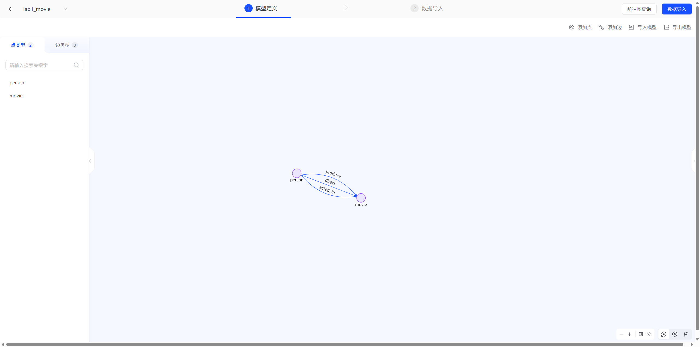

建标签的等价 Cypher 语句（见 [`cypher/01_schema.cql`](../cypher/01_schema.cql)）：

```cypher
CALL db.createVertexLabel('person','id',
  'id','INT64',false,'name','STRING',false,'born','INT32',true,'country','STRING',true)

CALL db.createVertexLabel('movie','id',
  'id','INT64',false,'title','STRING',false,'release_year','INT32',true,
  'rating','DOUBLE',true,'duration','INT32',true,'country','STRING',true)

CALL db.createEdgeLabel('direct',   '[["person","movie"]]')
CALL db.createEdgeLabel('acted_in', '[["person","movie"]]')
CALL db.createEdgeLabel('produce',  '[["person","movie"]]')

CALL db.addIndex('movie','title',false)
CALL db.addIndex('person','name',false)
```

> **踩坑记录**：字段类型必须写成**带引号的字符串** `'INT64'`，写成裸标识符 `INT64` 会报
> `CypherException: visit(...) failed at ast_expr_evaluator.cpp:480`。

校验 schema：

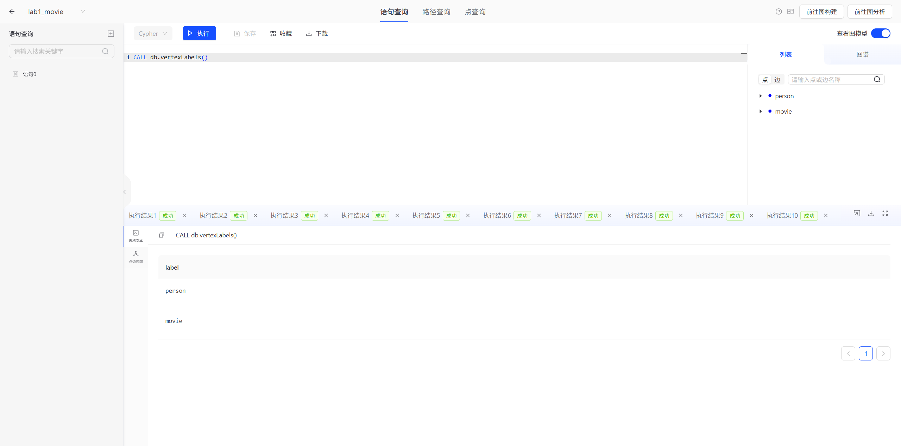

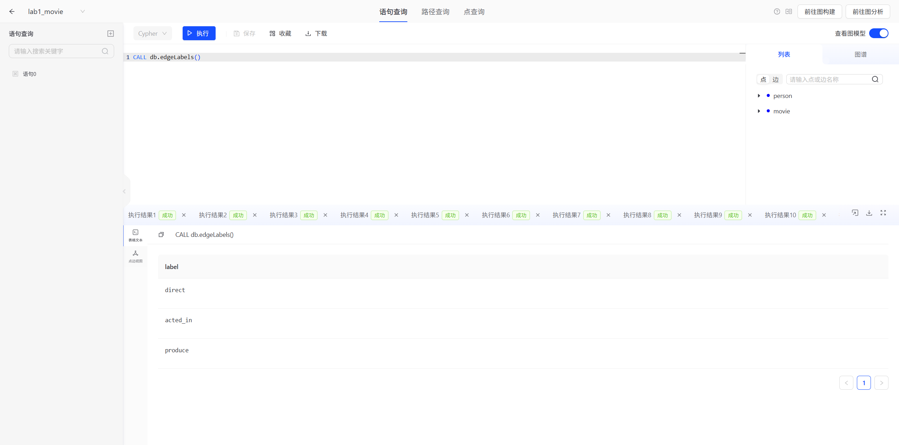

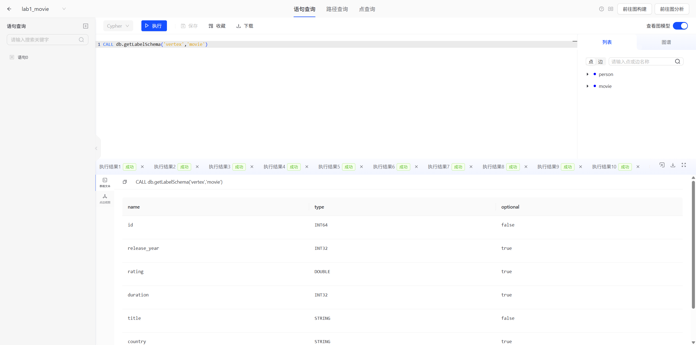

#### 4.2.2 数据导入

数据集为自建电影领域 CSV（UTF-8，首行表头）：

| 文件 | 表头 | 行数 |
|---|---|---|
| `data/person.csv` | `id,name,born,country` | 37 |
| `data/movie.csv` | `id,title,release_year,rating,duration,country` | 30 |
| `data/direct.csv` | `src_id,dst_id` | 30 |
| `data/acted_in.csv` | `src_id,dst_id` | 47 |
| `data/produce.csv` | `src_id,dst_id` | 6 |

本实验采用 **TuGraph RESTful API 批量写入**：登录拿 JWT，然后逐批 POST `/cypher`。顶点按 10 条一批拼成单条 `CREATE`，边则用 `MATCH ... CREATE` 逐条建立。

```powershell
# 1) 登录获取 JWT
POST /login   {"user":"admin","password":"73@TuGraph"}   ->  {"jwt": "..."}

# 2) 批量建顶点（每批 10 条）
POST /cypher  {"graph":"lab1_movie",
               "script":"CREATE (p10001:person{id:10001,name:'Francis Ford Coppola',born:1939,country:'美国'}), ..."}

# 3) 建边
POST /cypher  {"graph":"lab1_movie",
               "script":"MATCH (a:person{id:10001}),(b:movie{id:20002}) CREATE (a)-[:direct]->(b)"}
```

导入脚本见 [`scripts/import_via_rest.ps1`](../scripts/import_via_rest.ps1)。

> Web 界面「图构建 → 数据导入」也支持上传 CSV 并做列映射，效果等价；本实验因数据量与传统 UI 点击成本，选择接口批量写入，并在下文用界面查询验证结果。

导入后的数据明细（按评分降序取前 8 部）：

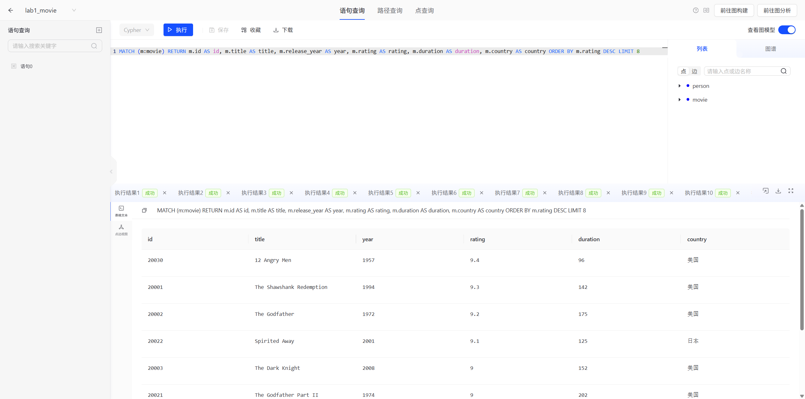

#### 4.2.3 导入结果校验

| 校验项 | 期望 | 实际 |
|---|---|---|
| person 顶点 | 37 | ✅ 37 |
| movie 顶点 | 30 | ✅ 30 |
| direct 边 | 30 | ✅ 30 |
| acted_in 边 | 47 | ✅ 47 |
| produce 边 | 6 | ✅ 6 |
| **顶点合计** | **67** | ✅ **67** |
| **边合计** | **83** | ✅ **83** |


![MATCH ()-[r]->() RETURN COUNT(r) => 83](../screenshots/08-count-edges.png)

#### 4.2.4 增删改查

完整脚本见 [`cypher/02_crud.cql`](../cypher/02_crud.cql)。为不与正式数据集冲突，临时数据统一使用 `1990x` / `2990x` 段 ID。

**（1）增 —— CREATE 顶点**

```cypher
CREATE (p:person{id:19901,name:'Ryan Gosling',born:1980,country:'Canada'}),
       (d:person{id:19902,name:'Denis Villeneuve',born:1967,country:'Canada'}),
       (m:movie{id:29901,title:'Blade Runner 2049',release_year:2017,rating:8.3,duration:164,country:'USA'})
```

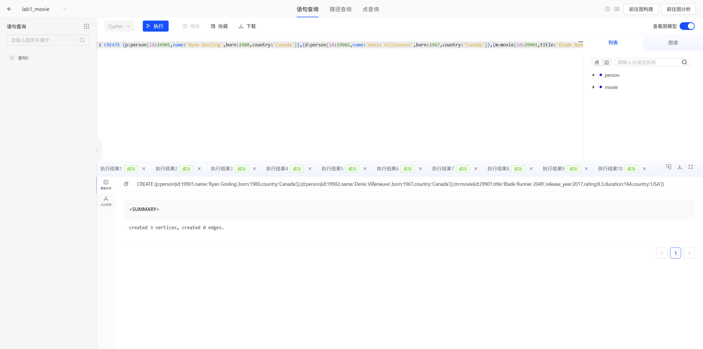

**（2）增 —— CREATE 关系**

```cypher
MATCH (p:person{id:19901}),(d:person{id:19902}),(m:movie{id:29901})
CREATE (d)-[:direct]->(m), (p)-[:acted_in]->(m)
```

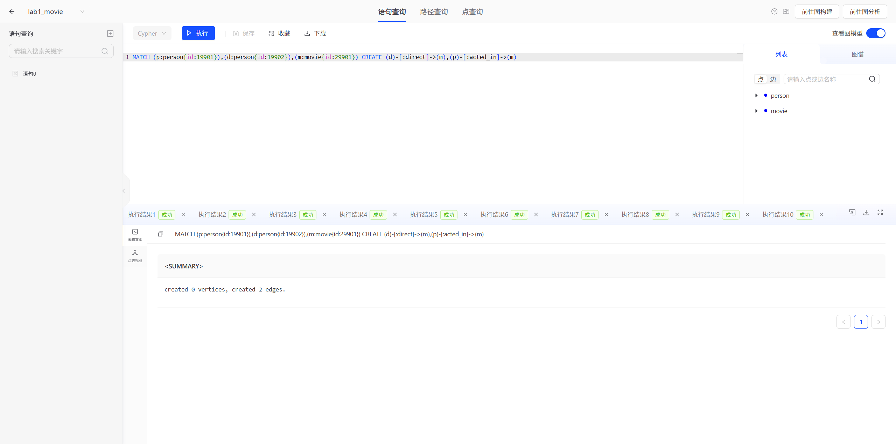

**（3）查 —— MATCH / RETURN（两跳路径）**

```cypher
MATCH (p:person)-[r]->(m:movie{id:29901})
RETURN p.name AS person, type(r) AS relation, m.title AS movie
```

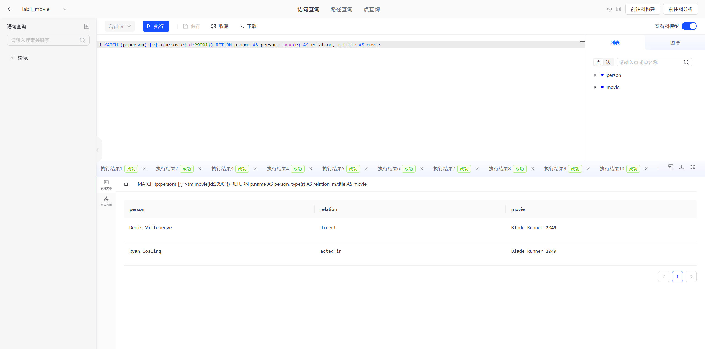

新增后顶点总数由 67 变为 **70**：


**（4）改 —— SET**

```cypher
MATCH (m:movie{id:29901})
SET m.rating = 8.4
SET m.tagline = 'There is an order to things.'
RETURN m
```

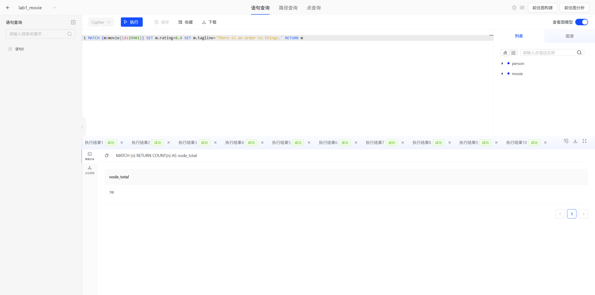

**（5）删属性 —— REMOVE**

```cypher
MATCH (m:movie{id:29901}) REMOVE m.tagline RETURN m
```

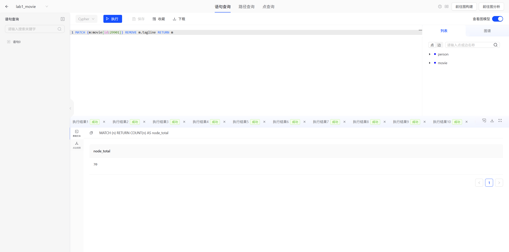

**（6）删节点 —— DELETE**

```cypher
MATCH (m:movie{id:29901})-[r]-() DELETE r, m
MATCH (m:movie{id:29901}) DELETE m
-- person 同理
```

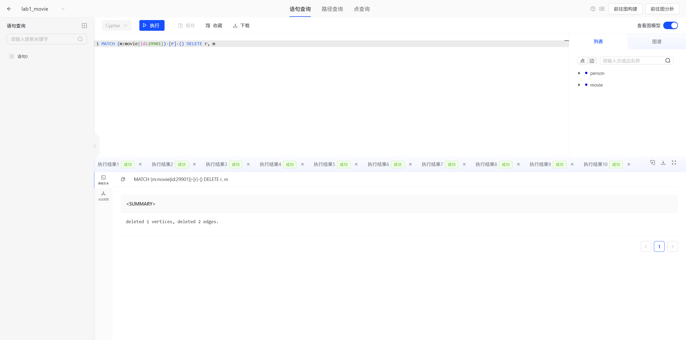

> **要点**：`DELETE` 用于删除节点和关系，`REMOVE` 用于删除节点/关系的**属性与标签**，两者都必须配合 `MATCH` 先定位再操作。删除仍有边的节点会被数据库拒绝，因此**必须先删边再删点**。

删除后复核：顶点回到 **67**，边回到 **83**，数据恢复初始状态：

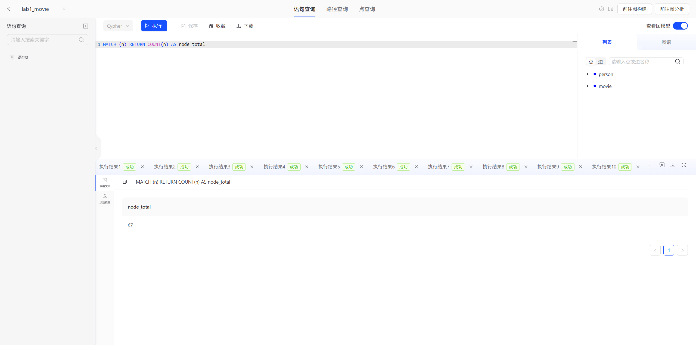

---

### 4.3 任务三：自定义聚合查询设计（4 分）

#### 4.3.1 业务问题

影视资料库的运营需要回答三类聚合问题：

- **Q1**：哪位**导演**的作品**平均口碑最高**？（核心示例）
- **Q2**：哪位导演的**"演员资源池"最大**？（两跳 + 去重计数）
- **Q3**：各**出品国**的产量与平均评分分布如何？（隐式分组）
- **Q4**：哪些**演员**出演的片子平均分最高？
- **Q5**：全库的整体统计指标？

#### 4.3.2 设计思路

Cypher 与 SQL 在聚合上有三个关键差异，本实验的查询正是围绕它们设计的：

| 差异点 | SQL | Cypher |
|---|---|---|
| 分组方式 | 显式 `GROUP BY` | **无 `GROUP BY`**，`RETURN` / `WITH` 中**非聚合表达式自动成为分组键**（隐式分组） |
| 聚合后过滤 | `HAVING` | 在 `WITH ...` 之后接 `WHERE` |
| 多阶段处理 | 子查询 / CTE | **`WITH`** 串联查询阶段，可多次聚合、多次过滤 |

**Q1 的关键设计**：如果直接 `RETURN d.name, AVG(m.rating)` 并按平均分排序，只拍过 **1 部**影片的导演会因为"样本量小"而虚高登顶。因此必须先聚合出作品数，再用 `WHERE` 把作品数 < 2 的导演过滤掉 —— 这等价于 SQL 的 `HAVING COUNT(*) >= 2`。

#### 4.3.3 Q1 核心示例：导演口碑排行榜

```cypher
MATCH (d:person)-[:direct]->(m:movie)
WITH d, COUNT(m) AS movieCount, AVG(m.rating) AS avgRating
WHERE movieCount >= 2
RETURN d.name AS director, movieCount, avgRating
ORDER BY avgRating DESC, movieCount DESC
LIMIT 10
```

**逐句解析**

| 子句 | 作用 |
|---|---|
| `MATCH (d:person)-[:direct]->(m:movie)` | 沿 `direct` 边展开"导演→影片"一对多关系，得到 (导演, 影片) 明细行 |
| `WITH d, COUNT(m) AS movieCount, AVG(m.rating) AS avgRating` | 以 `d` 为分组键做**隐式分组**，聚合出作品数与平均分 |
| `WHERE movieCount >= 2` | 对**聚合结果**过滤，等价于 `HAVING COUNT(*) >= 2` |
| `ORDER BY avgRating DESC, movieCount DESC` | 平均分降序；平均分相同则作品多的优先 |
| `LIMIT 10` | 只取前 10 名 |

**运行结果**

| 导演 | 作品数 | 平均评分 |
|---|---|---|
| Hayao Miyazaki | 2 | 9.0000 |
| Frank Darabont | 2 | 8.9500 |
| Francis Ford Coppola | 3 | 8.9000 |
| David Fincher | 3 | 8.6000 |
| Robert Zemeckis | 3 | 8.4667 |
| Bong Joon-ho | 2 | 8.4000 |
| Christopher Nolan | 8 | 8.3875 |
| Quentin Tarantino | 3 | 8.3000 |
| Lana Wachowski | 3 | 7.6000 |

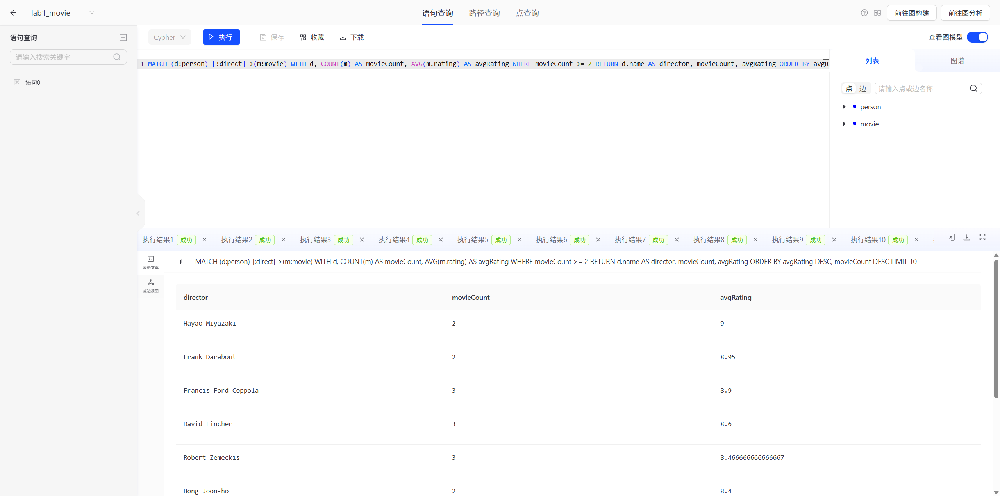

**结果分析**

- **宫崎骏**以 9.0 的平均分登顶，两部作品（《千与千寻》9.1、《幽灵公主》8.9）水准极其稳定；
- **诺兰**作品最多（8 部），平均分仅排第 7（8.3875），原因是《信条》7.4、《敦刻尔克》7.8 拉低了均值 —— 这说明**"产量"与"口碑"是两个独立维度**，`ORDER BY` 的维度选择直接决定榜单含义；
- 榜单尾部的**沃卓斯基**平均 7.6，被《黑客帝国 3》6.9 拖累，体现了 `AVG` 对**离群值敏感**的特性。

#### 4.3.4 Q1-a 对照组：不加 `WHERE` 会怎样

```cypher
MATCH (d:person)-[:direct]->(m:movie)
RETURN d.name AS director, COUNT(m) AS movieCount, AVG(m.rating) AS avgRating
ORDER BY avgRating DESC
LIMIT 10
```

| 导演 | 作品数 | 平均评分 |
|---|---|---|
| **Sidney Lumet** | **1** | **9.4000** |
| Hayao Miyazaki | 2 | 9.0000 |
| Frank Darabont | 2 | 8.9500 |
| Francis Ford Coppola | 3 | 8.9000 |
| David Fincher | 3 | 8.6000 |
| Robert Zemeckis | 3 | 8.4667 |
| Bong Joon-ho | 2 | 8.4000 |
| Christopher Nolan | 8 | 8.3875 |
| Quentin Tarantino | 3 | 8.3000 |
| Lana Wachowski | 3 | 7.6000 |

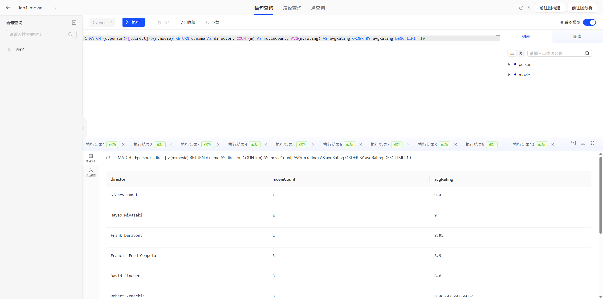

**对比结论**：西德尼·吕美特凭《十二怒汉》（9.4）一部片直接登顶，但**样本量只有 1**，无法代表其整体水准。加 `WHERE movieCount >= 2` 后榜单才具备统计意义 —— 这正是**聚合结果需要二次过滤（HAVING）**的典型场景。

#### 4.3.5 Q1-b 变体：换个维度看"劳模导演"

```cypher
MATCH (d:person)-[:direct]->(m:movie)
RETURN d.name AS director, COUNT(m) AS movieCount, AVG(m.rating) AS avgRating
ORDER BY movieCount DESC
LIMIT 5
```

| 导演 | 作品数 | 平均评分 |
|---|---|---|
| Christopher Nolan | 8 | 8.3875 |
| Francis Ford Coppola | 3 | 8.9000 |
| David Fincher | 3 | 8.6000 |
| Quentin Tarantino | 3 | 8.3000 |
| Lana Wachowski | 3 | 7.6000 |

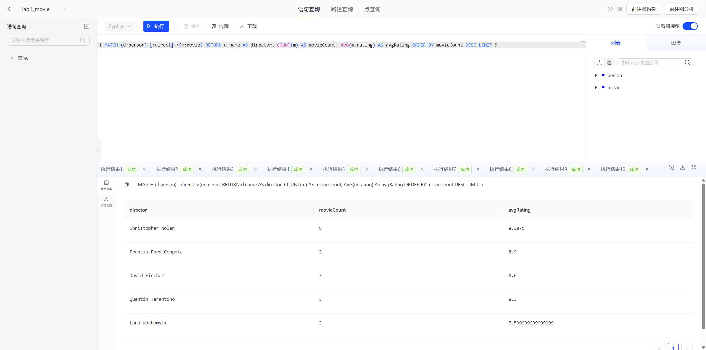

> 同一份数据、同一个聚合函数，仅改变 `ORDER BY` 维度，就从"口碑榜"变成"产量榜"。这也暴露了 `COUNT` 相同（都是 3 部）时排序不确定的问题 —— 截图中并列 3 部的四位导演顺序并非按平均分排列，工程上应追加第二排序键（如 `ORDER BY movieCount DESC, avgRating DESC`）保证结果稳定。

#### 4.3.6 Q2 进阶：两跳聚合 + 去重计数

**业务问题**：哪位导演的"演员资源池"最大？

**难点**：路径是 `导演 -direct-> 影片 <-acted_in- 演员`，如果直接 `COUNT(a)`，同一位演员与同一导演合作多部片会被**重复计数**。

```cypher
MATCH (d:person)-[:direct]->(m:movie)<-[:acted_in]-(a:person)
WITH d, m, COUNT(DISTINCT a) AS castSize
RETURN d.name AS director, COUNT(m) AS movies, SUM(castSize) AS castPool
ORDER BY castPool DESC, movies DESC
LIMIT 5
```

| 导演 | 影片数 | 演员池规模 |
|---|---|---|
| Christopher Nolan | 7 | 19 |
| Francis Ford Coppola | 3 | 5 |
| Quentin Tarantino | 3 | 5 |
| Robert Zemeckis | 3 | 4 |
| David Fincher | 2 | 4 |

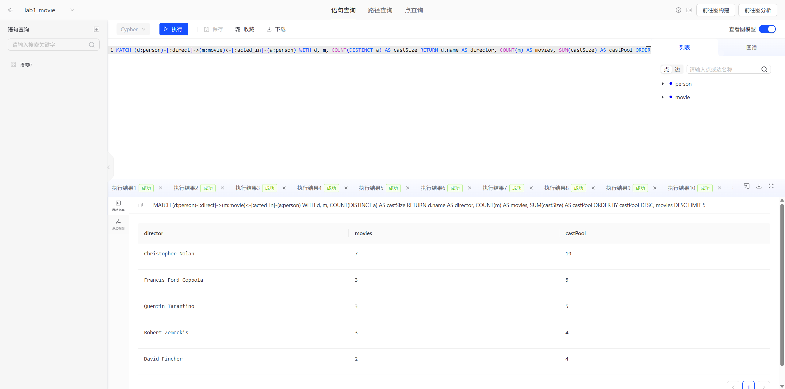

**设计要点（两级聚合成环）**

1. **内层** `WITH d, m, COUNT(DISTINCT a)`：把聚合粒度固定为 **(导演, 影片)**，先算出**每部片的演员数**，`DISTINCT` 保证同一部片里同一演员只算一次；
2. **外层** `RETURN d.name, COUNT(m), SUM(castSize)`：再把粒度提升到**导演**，对每片演员数求和。

这是 Cypher 有别于 SQL 的典型写法：`WITH` 让同一个查询里出现**两级不同的分组粒度**，无需嵌套子查询。

> **一个值得注意的现象**：Q1 里诺兰执导了 **8 部**影片，但 Q2 里只统计出 **7 部**。原因是 `Memento` 在数据集中没有 `acted_in` 边（该片只登记了导演），而 `MATCH (d)-[:direct]->(m)<-[:acted_in]-(a)` 是**模式匹配**，要求路径三段都存在，因此无演员的影片被自动剔除。同理芬奇的 `The Social Network` 也因无演员数据而未计入。这提醒我们：**多跳模式匹配等同于 SQL 的 INNER JOIN**，会让"单边不完整"的记录静默消失。

#### 4.3.7 Q3 进阶：隐式分组 + 多聚合函数

```cypher
MATCH (m:movie)
RETURN m.country AS country,
       COUNT(m) AS movies,
       AVG(m.rating) AS avgRating,
       MAX(m.rating) AS maxRating,
       MIN(m.rating) AS minRating
ORDER BY movies DESC, avgRating DESC
```

| 出品国 | 影片数 | 平均评分 | 最高评分 | 最低评分 |
|---|---|---|---|---|
| 美国 | 25 | 8.4880 | 9.4 | 6.9 |
| 日本 | 2 | 9.0000 | 9.1 | 8.9 |
| 韩国 | 2 | 8.4000 | 8.5 | 8.3 |
| 英国 | 1 | 7.8000 | 7.8 | 7.8 |

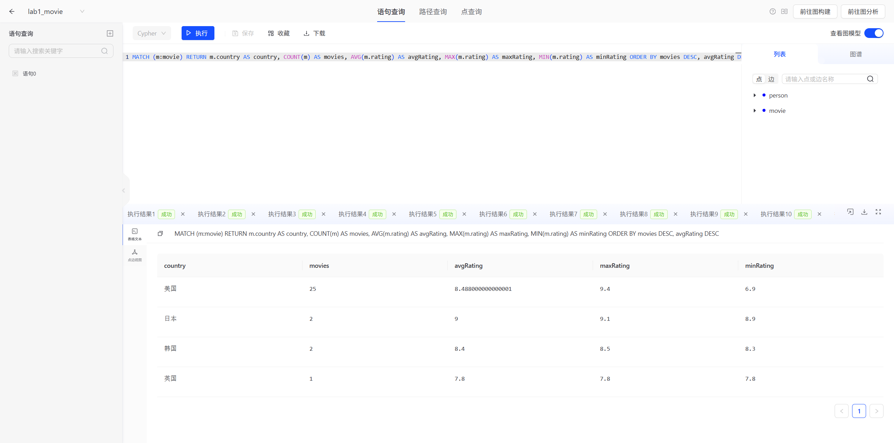

**要点**：`RETURN` 中 `m.country` 是**唯一非聚合表达式**，因此自动成为分组键 —— 这就是**隐式分组**。一次 `RETURN` 可同时挂多个聚合函数（`COUNT` / `AVG` / `MAX` / `MIN`）。

**结论**：日本动画虽然只有 2 部，平均分（9.0）却显著高于美国的 8.4880，说明"小而精"；美国样本量大（25 部）且极差达 2.5（9.4 ~ 6.9），更能反映商业片的波动。

#### 4.3.8 Q4 进阶：演员口碑榜

```cypher
MATCH (p:person)-[:acted_in]->(m:movie)
WITH p, COUNT(m) AS movieCount, AVG(m.rating) AS avgRating
WHERE movieCount >= 2
RETURN p.name AS actor, movieCount, avgRating
ORDER BY avgRating DESC
LIMIT 5
```

| 演员 | 出演片数 | 平均评分 |
|---|---|---|
| Al Pacino | 2 | 9.1000 |
| Morgan Freeman | 4 | 8.9250 |
| Marlon Brando | 2 | 8.8500 |
| Cillian Murphy | 3 | 8.8000 |
| Christian Bale | 2 | 8.7500 |

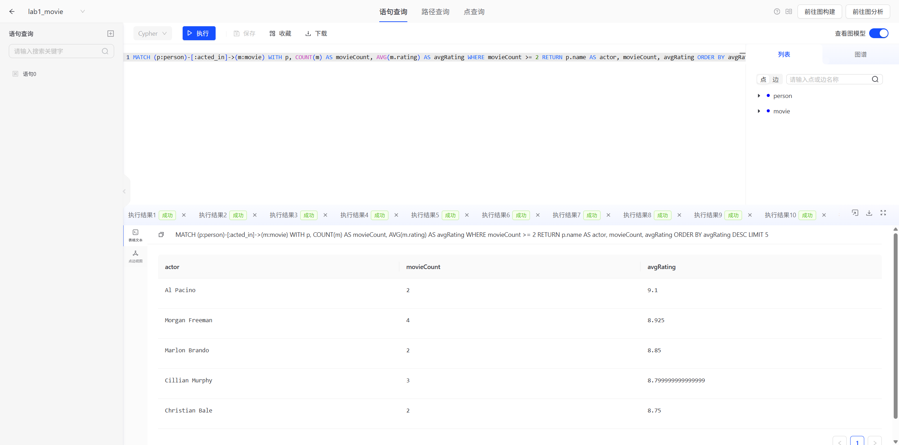

#### 4.3.9 Q5 进阶：无分组键的全库聚合

```cypher
MATCH (m:movie)
RETURN COUNT(m) AS movie_total, AVG(m.rating) AS avg_rating,
       MAX(m.duration) AS max_duration, MIN(m.duration) AS min_duration
```

| 影片总数 | 全库平均评分 | 最长片长 | 最短片长 |
|---|---|---|---|
| 30 | 8.4933 | 202 | 96 |

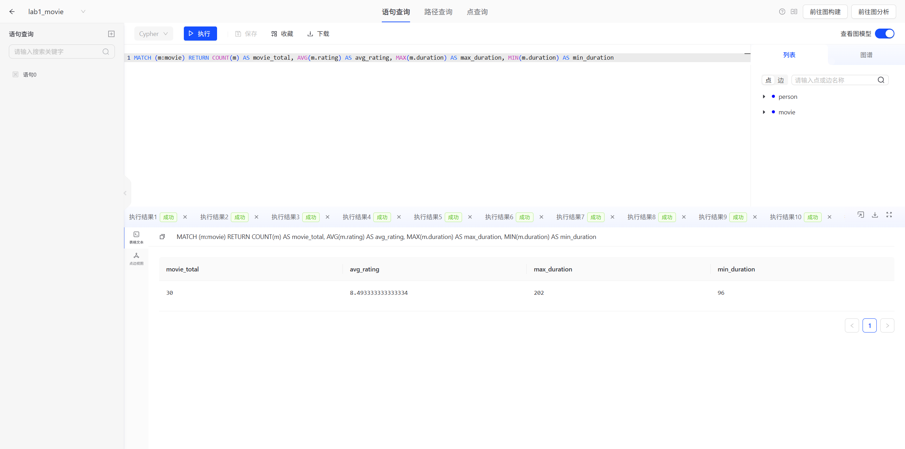

**要点**：`RETURN` 中没有任何非聚合表达式时，整个结果集就是**一个分组**，返回单行汇总 —— 即 SQL 中"不带 GROUP BY 的聚合查询"。

#### 4.3.10 Cypher 聚合查询要点小结

| 序号 | 要点 | 说明 |
|---|---|---|
| 1 | **隐式分组** | 无 `GROUP BY`；`RETURN`/`WITH` 中非聚合表达式即分组键；无分组键则整表聚合为一行 |
| 2 | **`WHERE` 的位置决定语义** | `MATCH ... WHERE` 过滤**明细行**；`WITH ... WHERE` 过滤**聚合结果**（= `HAVING`） |
| 3 | **`WITH` 是多阶段枢纽** | 串联多级聚合、传递中间结果、重命名与列裁剪 |
| 4 | **`COUNT(DISTINCT x)` 去重** | 多跳路径必然产生重复组合，计数前必须去重 |
| 5 | **模式匹配是"内连接"** | 多跳路径要求每段都存在，缺边记录会静默消失（见 Q2 的 7 vs 8） |
| 6 | **`AVG` 对离群值敏感** | 榜单尾部容易被个别低分作品拖累，必要时用 `MIN`/`MAX` 佐证 |
| 7 | **排序必须稳定** | 聚合值相同时应追加第二排序键，否则结果顺序不确定 |

---

## 五、遇到的问题与解决

| # | 问题现象 | 原因分析 | 解决方案 |
|---|---|---|---|
| 1 | 阿里云计算巢试用下单失败：`配额不足`，`q_user_poc_instance_create_times_of_any_service 已达到上限` | 该账号此前已创建过一次 TuGraph 试用实例（已于 2026-10-15 到期销毁），而"每个服务可创建试用实例次数"配额为 1、已用 1 | 在配额中心提交提升申请（1→2），状态为审批中；同时改走本地部署 |
| 2 | 从服务目录点「开始部署」进入的创建页，「部署区域」提示"无可选的可用区" | 该入口是**通用创建页**，其可用区列表受按量付费库存与试用资格双重约束 | 需使用带 `isTrial=true` 的**官方试用链接**才会出现可用区 J / K |
| 3 | 本地无 Docker，`wsl --status` 提示未安装；管理员权限不足 | 实验机为 Windows 11 家庭版，未预装 Docker Desktop / WSL2 | 以管理员权限用 `dism` 启用 WSL 与虚拟机平台功能 |
| 4 | 启用功能并重启后，导入发行版报 `HCS_E_HYPERV_NOT_INSTALLED`，`HypervisorPresent` 恒为 `False` | 机器上安装了 **VMware Workstation** 与 **EasyAntiCheat**，两者与 Hyper-V hypervisor 冲突；`hypervisorlaunchtype` 已是 `Auto` 仍无法启动 | **改用 WSL1**（`--version 1`）：WSL1 是系统调用翻译层，不需要 hypervisor，问题绕开 |
| 5 | 极简 Ubuntu 根文件系统缺 CA 证书，HTTPS 源不可用；也无 `curl`/`wget` | `ubuntu-base` 仅含最基础包 | apt 源改用 HTTP 的清华镜像先装 `ca-certificates`；需要下载的文件改从 Windows 侧用 `curl` 下载后经 `/mnt/d` 传入 |
| 6 | `lgraph_server` 启动报 `liblgraph.so`、`libvsag.so` 找不到 | deb 把自有库装在 `/usr/local/lib64/lgraph`，不在默认动态库搜索路径 | `echo /usr/local/lib64/lgraph > /etc/ld.so.conf.d/lgraph.conf && ldconfig` |
| 7 | 继续报 `libgomp.so.1`、`libgfortran.so.4` 缺失；装 `libgfortran5` 后仍报 `version 'GFORTRAN_7' not found` | `libvsag.so` 由 GCC7 编译，需要 `GFORTRAN_7` 符号；Ubuntu 20.04 只提供 `libgfortran.so.5`，软链过去版本符号不匹配 | 从 Ubuntu 18.04 池安装真正的 `libgfortran4_7.5.0-3ubuntu1~18.04_amd64.deb` |
| 8 | 带 `--reset_admin_password true` 启动后，服务刚 `Server started` 就 `Server shutdown` | 该参数的语义是"重置密码后退出"，属于预期行为 | 重置完成后去掉该参数重新启动即可常驻 |
| 9 | 建标签报 `CypherException: visit(...) failed at ast_expr_evaluator.cpp:480` | 字段类型写成了裸标识符 `INT64`，被当作表达式求值 | 类型必须写成带引号的字符串 `'INT64'`、`'STRING'`、`'DOUBLE'` |
| 10 | 查询执行成功（界面显示"成功"）但结果区空白 | 结果区默认停在**「点边视图」**（Graphin 画布），聚合结果没有图，故画布空白 | 切换到左侧**「表格文本」**标签即可看到结果表格 |
| 11 | 建标签后查询报字段不存在 | 字段名 `year` 与 Cypher 内置时间函数同名 | 改名为 `release_year`，避开保留字 |
| 12 | 删除影片节点时报"节点仍有边" | 节点上还挂着 `direct` / `acted_in` 边 | 先 `DELETE` 边再 `DELETE` 节点，或用 `MATCH (n)-[r]-() DELETE r, n` 一并删除 |
| 13 | 下载 TuGraph 安装包（575.7 MB）极慢，直连与多数 GitHub 加速代理仅 26~178 KB/s | 国际链路拥塞，加速代理亦被限速 | 启用代理后从 GitHub 直连下载，实测 **9.1 MB/s**，63 秒完成 |

---

## 六、实验总结

### 6.1 完成情况

| 任务 | 要求 | 完成情况 |
|---|---|---|
| 任务 1 | 成功启动 TuGraph，文字描述部署步骤，展示登录截图 | ✅ 在 WSL1 + Ubuntu 20.04 上以官方 deb 原生部署 TuGraph 4.5.2，整理 6 步部署流程（含依赖修复），附登录与控制台截图 |
| 任务 2 | 模型建立、数据导入、增删改查，截图展示运行结果 | ✅ 设计 2 类顶点 / 3 类边 / 16 个属性字段的图模型，导入 67 顶点 83 边并逐项校验，完成增删改查全套操作并截图 |
| 任务 3 | 自行设计一个聚合查询例子，截图展示运行结果 | ✅ 设计"导演口碑榜"核心聚合查询，并扩展到 5 组查询，覆盖隐式分组、HAVING、去重计数、两跳聚合 |
| 任务 4 | 通过 GitHub 提交报告，链接放入学习通回答 | ✅ 报告与全部脚本、数据、24 张截图已推送 GitHub 仓库 |

### 6.2 收获与体会

1. **从"表"到"图"的思维转换**
   关系型建模习惯先想"有几张表、怎么 JOIN"；图建模的第一步是问"**实体是什么、实体之间的关系是什么**"。本实验中 `person` 与 `movie` 是实体，执导/出演/制片是关系，三种关系共用同一对顶点标签，模型比"三张关联表"直观得多。

2. **Cypher 的"声明式"体现在哪里**
   `MATCH (d:person)-[:direct]->(m:movie)` 只描述"我要什么样的路径"，至于怎么走、走索引还是全表扫描，由查询引擎决定。写 Cypher 时关注的是**路径模式**而非执行计划，这是它比 SQL 更适合表达多跳关联的根本原因。

3. **聚合查询最容易被忽略的是"粒度"**
   Q2 是最有代表性的一题：如果直接 `COUNT(a)` 而不先按 (导演, 影片) 分组、不用 `DISTINCT`，得到的是一个既非"总合作次数"也非"演员人数"的四不像数字。**写聚合前必须先明确"这一行代表什么"**。

4. **模式匹配的"内连接"语义会静默丢数据**
   Q2 中诺兰的影片数从 8 变成 7，原因就是 `Memento` 没有 `acted_in` 边。这类问题不会报错、也不会告警，只能靠"两个数字对不上"发现。**做图分析一定要先核对数据完整性**。

5. **部署层面最大的教训：环境适配比想象中重要**
   阿里云试用配额受限、Docker 需管理员权限、WSL2 又被 VMware/EasyAntiCheat 挡住 hypervisor——三条常规路径全部中断。最后靠"官方 deb + WSL1"这条非常规组合跑通，说明**读懂一个软件的依赖边界（TuGraph 的 deb 自带全部运行库、不依赖 Docker）比死磕标准流程更有效**。

6. **对 TuGraph 的评价**
   TuGraph 的 Bolt 协议兼容 Neo4j，现成的 Neo4j 驱动与 Cypher 代码几乎零成本迁移；Web 控制台的可视化建图与数据导入对新手友好。作为国产图数据库，其工具链完整度已经相当成熟。

## 七、参考资料

1. TuGraph 官网：<https://tugraph.tech/?lang=zh-CN>
2. TuGraph 开源社区：<https://github.com/TuGraph-family/tugraph-db>
3. TuGraph Cypher 接口文档：<https://tugraph-db.readthedocs.io/zh-cn/v3.5.0/5.developer-manual/6.interface/1.cypher.html>
4. TuGraph 数据库运行与配置参数：<https://tugraph-db.readthedocs.io/zh-cn/v4.3.0/5.installation%26running/7.tugraph-running.html>
5. TuGraph Bolt 客户端文档：<https://github.com/TuGraph-family/tugraph-db/blob/master/docs/zh-CN/source/7.client-tools/5.bolt-client.md>
6. TuGraph 发行版下载：<https://github.com/TuGraph-family/tugraph-db/releases>
7. 阿里云计算巢 TuGraph 服务部署文档
8. Neo4j Python Driver 文档：<https://neo4j.com/docs/python-manual/current/>
9. 图数据库基础概念：<https://blog.csdn.net/cacique111/article/details/126842771>

---

## 附录 A：数据字典

### A.1 顶点：`person`（37 条）

| 字段 | 类型 | 说明 | 示例 |
|---|---|---|---|
| `id` | INT64 | 主键 | `10007` |
| `name` | STRING | 姓名 | `Christopher Nolan` |
| `born` | INT32 | 出生年份 | `1970` |
| `country` | STRING | 国籍 | `英国` |

### A.2 顶点：`movie`（30 条）

| 字段 | 类型 | 说明 | 示例 |
|---|---|---|---|
| `id` | INT64 | 主键 | `20003` |
| `title` | STRING | 片名 | `The Dark Knight` |
| `release_year` | INT32 | 上映年份 | `2008` |
| `rating` | DOUBLE | 综合评分 | `9.0` |
| `duration` | INT32 | 片长（分钟） | `152` |
| `country` | STRING | 出品国 | `美国` |

### A.3 边

| 标签 | 起点 | 终点 | 条数 |
|---|---|---|---|
| `direct` | person | movie | 30 |
| `acted_in` | person | movie | 47 |
| `produce` | person | movie | 6 |

### A.4 CSV 文件格式

所有 CSV 均为 UTF-8 编码，首行为表头。

| 文件 | 表头 | 行数 |
|---|---|---|
| `data/person.csv` | `id,name,born,country` | 37 |
| `data/movie.csv` | `id,title,release_year,rating,duration,country` | 30 |
| `data/direct.csv` | `src_id,dst_id` | 30 |
| `data/acted_in.csv` | `src_id,dst_id` | 47 |
| `data/produce.csv` | `src_id,dst_id` | 6 |

## 附录 B：脚本与文件索引

| 文件 | 说明 |
|---|---|
| [`cypher/01_schema.cql`](../cypher/01_schema.cql) | 建顶点/边标签、建索引、校验 schema |
| [`cypher/02_crud.cql`](../cypher/02_crud.cql) | 增删改查完整演示（含关系建立与清理） |
| [`cypher/03_aggregate.cql`](../cypher/03_aggregate.cql) | 自定义聚合查询 Q1~Q5 及对照组 |
| [`scripts/import_via_rest.ps1`](../scripts/import_via_rest.ps1) | 通过 REST 接口批量导入 CSV（本实验采用） |
| [`scripts/import_data.py`](../scripts/import_data.py) | 通过 Bolt 协议导入（备选方案） |
| [`scripts/run_queries.py`](../scripts/run_queries.py) | 批量执行聚合查询并打印表格 |
| [`deploy/wsl-native.md`](../deploy/wsl-native.md) | WSL1 + deb 原生部署完整步骤（本实验采用） |
| [`deploy/aliyun-computenest.md`](../deploy/aliyun-computenest.md) | 阿里云计算巢部署步骤（备用方案） |
| [`deploy/docker-local.md`](../deploy/docker-local.md) | 本地 Docker 部署命令解析与踩坑记录 |
| `screenshots/` | 24 张实验运行截图 |
